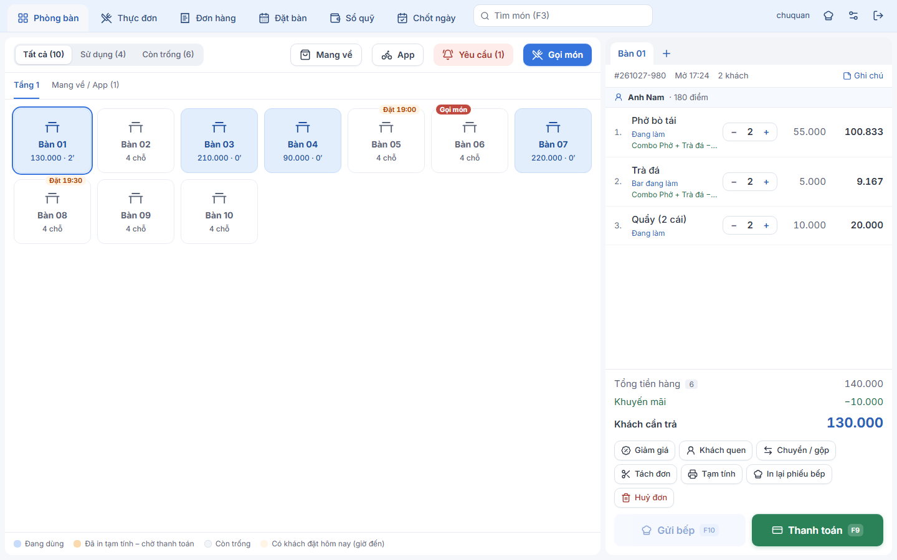
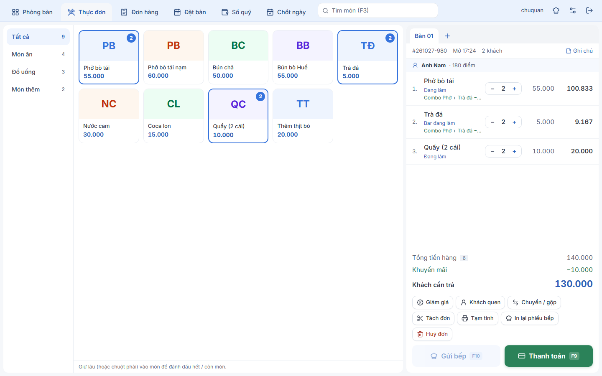
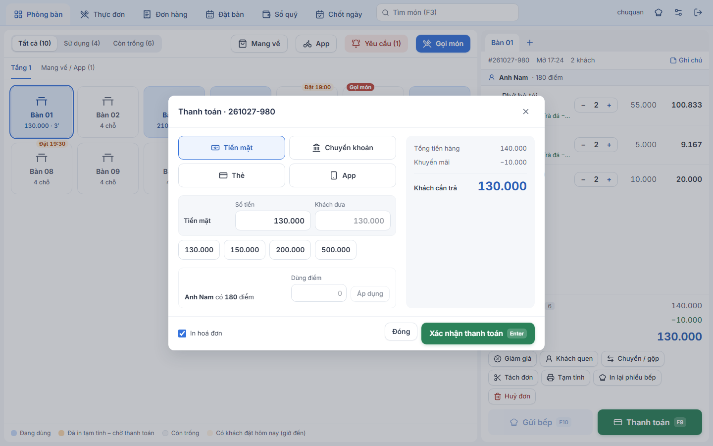
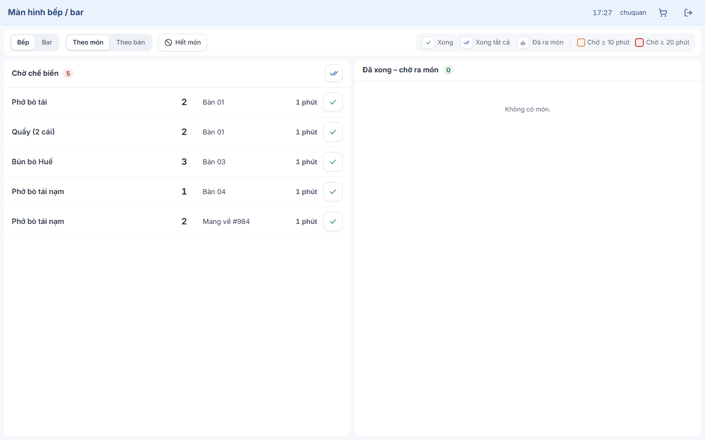
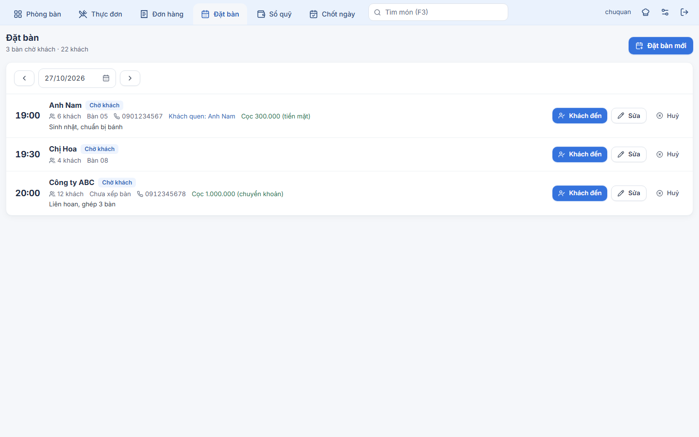
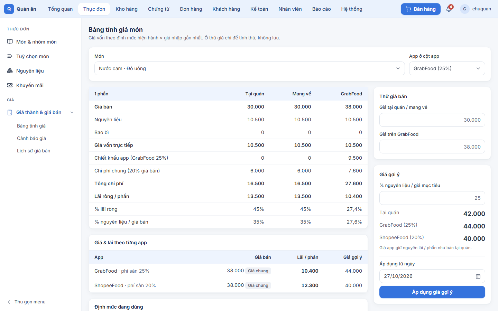
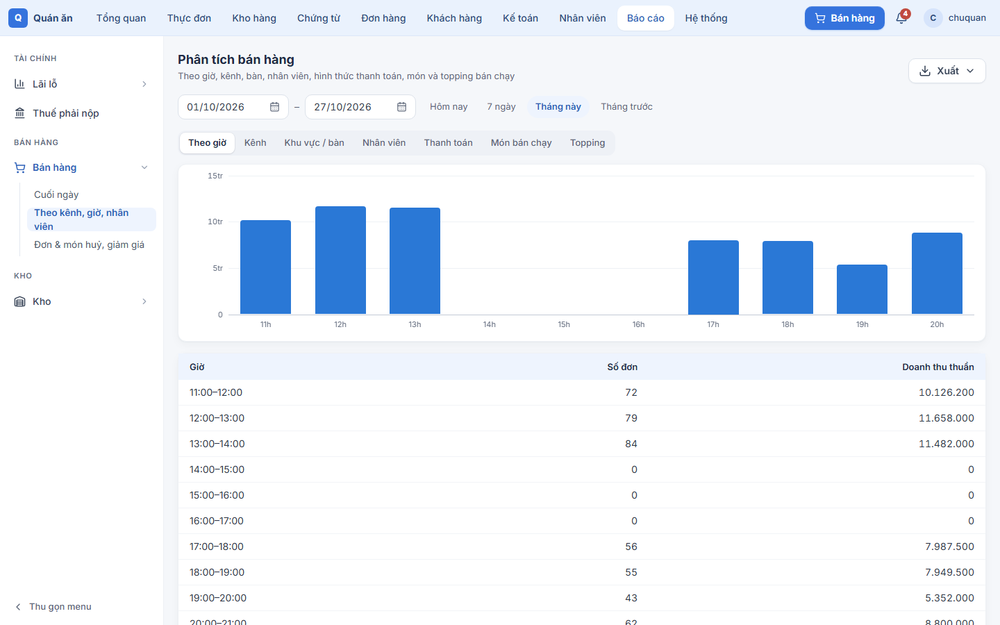
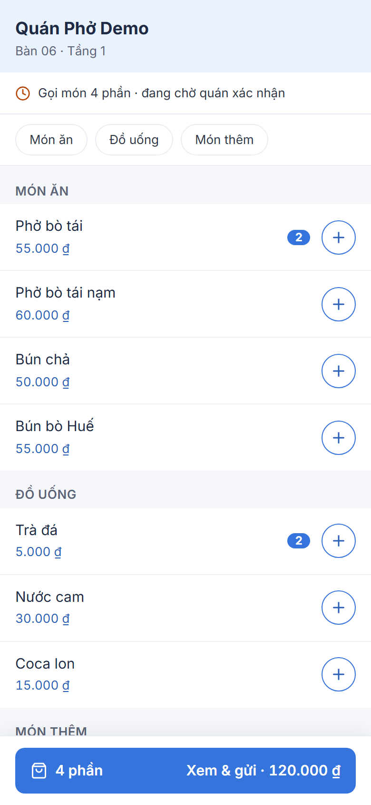

# Quán ăn — Bán hàng (POS) & Kế toán nội bộ

Bán hàng tại quầy (bàn, bếp / bar, thanh toán + VietQR tự xác nhận tiền về qua SePay / Casso, hoá đơn điện tử từ máy tính tiền, đơn app giao hàng, khách quen tích / đổi điểm, giờ vàng & combo tự áp, đặt bàn có tiền cọc, khách quét QR tại bàn để gọi món), kho FIFO theo lô (nhập, xuất, nợ kho, bán thành phẩm như nước dùng nấu theo mẻ,
kiểm kê, tồn tối thiểu & gợi ý nhập hàng), nhà cung cấp & công nợ, sổ quỹ tiền mặt, nhân viên (ca làm, chấm công,
bảng lương, tạm ứng), giá thành & giá bán từng món (giá tại quán, giá riêng từng app, lịch sử giá, lãi của size /
topping), lãi lỗ tháng / quý / năm, khoá sổ, lưu trữ chứng từ (ảnh / PDF / XML hoá đơn, tải file nén hoặc gửi lên
Google Drive), thuế hộ kinh doanh (GTGT + TNCN tạm tính, so sánh 2 cách tính, báo cáo "Thuế phải nộp"), sao lưu dữ
liệu tự động mỗi đêm (kèm bản trên Telegram / Google Drive; ảnh chứng từ lấy lại được từ Telegram) và báo cáo chốt ngày,
tin nhắc việc buổi sáng, cảnh báo gian lận gửi chủ quán qua Telegram.

## Hình ảnh

<table>
  <tr>
    <td width="50%"><br><sub><b>Sơ đồ bàn</b> — bàn đang dùng, giờ khách đặt, yêu cầu gọi món từ QR; đơn của bàn có combo và khách quen</sub></td>
    <td width="50%"><br><sub><b>Gọi món</b> — thực đơn theo nhóm, giá theo kênh bán, gửi bếp / bar</sub></td>
  </tr>
  <tr>
    <td><br><sub><b>Thanh toán</b> — nhiều hình thức, khuyến mãi tự áp, đổi điểm khách quen</sub></td>
    <td><br><sub><b>Màn hình bếp / bar</b> — món chờ theo trạm, cập nhật tức thì</sub></td>
  </tr>
  <tr>
    <td><br><sub><b>Đặt bàn</b> — giờ đến, bàn, tiền cọc; khách đến mở đơn đúng bàn</sub></td>
    <td><br><sub><b>Bảng tính giá</b> — giá vốn theo định mức × giá nhập, lãi từng kênh và từng app, giá gợi ý</sub></td>
  </tr>
  <tr>
    <td><br><sub><b>Báo cáo bán hàng</b> — theo giờ, kênh, bàn, nhân viên, hình thức thanh toán, món bán chạy</sub></td>
    <td align="center"><br><sub><b>Khách quét QR tại bàn</b> — xem thực đơn, gọi món, gọi nhân viên trên điện thoại</sub></td>
  </tr>
</table>

<sub>Ảnh chụp từ dữ liệu demo (<code>db:seed:demo</code> + <code>db:seed:demo-sales</code>), tên quán là tên giả.</sub>

| App        | Nội dung                                                                                                                                                  |
| ---------- | --------------------------------------------------------------------------------------------------------------------------------------------------------- |
| `apps/api` | Express + Socket.IO + Prisma (PostgreSQL). `src/domain` nghiệp vụ thuần, `src/contracts` hợp đồng API (ts-rest), `prisma/sql` truy vấn báo cáo (TypedSQL) |
| `apps/web` | React + Vite + Tailwind v4: `/pos` bán hàng, `/kitchen` bếp / bar, `/admin` quản trị & báo cáo                                                            |
| `e2e`      | Playwright: bán hàng, kiểm kê, chứng từ, trợ năng (a11y), cài mới từ đầu                                                                                  |

Sơ đồ hệ thống, database và API (luôn khớp phiên bản đang chạy): `/api/docs/architecture` — dev: http://localhost:4000/api/docs/architecture.

Tài liệu: [kiến trúc](docs/architecture.md) · [quy tắc nghiệp vụ](docs/business-rules.md) · [cài máy chủ tại quán](docs/setup-store.md) · [máy in](docs/setup-printer.md) · [Google Drive](docs/setup-google-drive.md) · [Telegram](docs/setup-telegram.md) · [tự xác nhận chuyển khoản](docs/setup-bank-feed.md) · [gọi món QR tại bàn](docs/setup-qr-order.md) · [thuế GTGT & hộ kinh doanh](docs/thue-gtgt-viet-nam.md) · [áp dụng thuế trong app](docs/ap-dung-thue-trong-app.md)

## Chạy trên máy dev

Cần: Node ≥ 20 (khuyên 24), pnpm (`corepack enable`), Docker Desktop.

```bash
pnpm install
docker compose up -d                       # PostgreSQL ở cổng 5433 (+ DB test ketoan_test)
cp apps/api/.env.example apps/api/.env     # rồi đổi JWT_SECRET
pnpm db:migrate                            # tạo bảng
pnpm db:generate                           # Prisma client + hàm TypedSQL (cần DB đang chạy, API dev server đang tắt)
pnpm db:seed                               # cơ sở, tài khoản admin (in mật khẩu tạm), cài đặt, bàn mẫu
pnpm --filter @ketoan/api db:seed:demo        # (tuỳ chọn) thực đơn, định mức, tồn đầu mẫu
pnpm --filter @ketoan/api db:seed:demo-sales  # (tuỳ chọn) lịch sử bán hàng mẫu từ 01/09 để xem báo cáo
pnpm dev                                   # API :4000 (tài liệu API: /api/docs) + web :5173
```

Mở http://localhost:5173, đăng nhập `admin` bằng mật khẩu tạm in ra ở bước seed → đổi mật khẩu → đặt mã PIN duyệt.

## Lệnh thường dùng

| Lệnh                                                                      | Việc                                                                                                                                                   |
| ------------------------------------------------------------------------- | ------------------------------------------------------------------------------------------------------------------------------------------------------ |
| `pnpm test`                                                               | unit test (domain) + integration test (api, DB test)                                                                                                   |
| `pnpm e2e`                                                                | Playwright — tự chạy app riêng trên DB `ketoan_e2e` (không đụng DB dev, có cả test cài mới); vào app có sẵn thì đặt `BASE_URL`, `E2E_USER`, `E2E_PASS` |
| `pnpm lint` / `pnpm typecheck` / `pnpm build`                             | kiểm tra & build                                                                                                                                       |
| `pnpm db:migrate` / `pnpm db:generate` / `pnpm db:seed` / `pnpm db:reset` | quản lý DB                                                                                                                                             |
| `pnpm --filter @ketoan/api db:reset-admin`                                | quên mật khẩu `admin`: in mật khẩu tạm mới (phải đổi khi đăng nhập)                                                                                    |

Commit chạy `lint-staged` (eslint + prettier) qua husky. Không có CI: trước khi đưa lên máy chủ, chạy `pnpm lint`, `pnpm typecheck`, `pnpm test` (và `pnpm e2e` khi đổi luồng bán hàng / kho) trên máy dev.

## Chạy tại quán (production)

```powershell
copy .env.prod.example .env.prod   # điền mật khẩu DB, JWT_SECRET, SITE_HOSTS
docker compose -f docker-compose.prod.yml --env-file .env.prod up -d --build
powershell -ExecutionPolicy Bypass -File scripts\install-task.ps1   # (nên làm) 03:00 chép bản sao lưu + ảnh ra ổ ngoài
```

Database tự sao lưu lúc 02:00 vào `backups\` (Hệ thống → Cài đặt → Sao lưu dữ liệu); thiết lập Telegram
([hướng dẫn](docs/setup-telegram.md)) hoặc Google Drive ở Hệ thống → Cài đặt để có thêm bản ngoài máy chủ.
Chi tiết (chứng chỉ cho máy tính bảng, khôi phục bản sao lưu…): [docs/setup-store.md](docs/setup-store.md).

## Quy ước chính

- Nghiệp vụ nằm ở `apps/api/src/domain` (không phụ thuộc DB/HTTP, có unit test); service chỉ đọc/ghi DB và gọi domain.
- API khai báo một lần ở `apps/api/src/contracts`; web chỉ được import `@ketoan/api/contracts` và `@ketoan/api/domain` (ESLint chặn import khác).
- Feature bán hàng và feature quản trị trong `apps/web/src/features` không import lẫn nhau.
- Tiền là số nguyên đồng (Decimal), không dùng `number` để cộng tiền ở backend.
- Mọi sửa / huỷ / xoá / giảm giá / khoá sổ đều có lý do và ghi lịch sử sửa.
